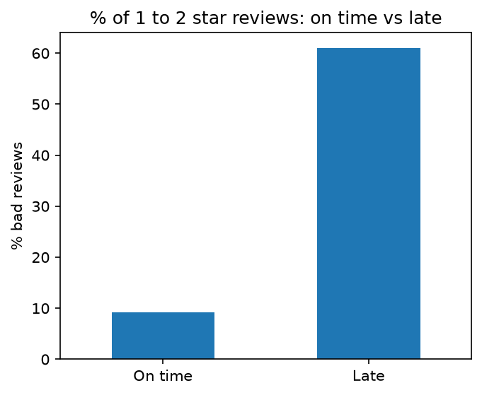

# Olist Review Intelligence

**Why do customers leave bad reviews, and what should a webshop fix first?**
Data analysis, machine learning and NLP on 99,441 e-commerce orders, tested on 30,000 Danish, Swedish and Norwegian Trustpilot reviews, and packaged as Review Radar: an app that reads reviews in any language.

## The problem

Nordic webshops collect reviews in several languages, and nobody has time to read them all. Complaints get noticed late, and teams fix what is loudest instead of what costs the most. This project finds what drives bad reviews in real order data, predicts which orders are at risk before the review is written, and turns review text in any language into themes a marketing or customer-experience team can act on.

## Key findings

1. **Late delivery is the strongest driver of bad reviews.** 61% of late orders get a 1 or 2 star review, against 9.2% of on-time orders. Customers punish broken promises more than slow delivery.
2. **Multi-item orders often arrive incomplete.** They are about 10% of orders but a fifth of bad reviews. A model plus a simple rule reach 38% of bad reviews while contacting 12% of orders, before the review is written.
3. **Almost nobody comes back.** Only 3.1% of 96,096 customers ordered twice, after good and bad first orders alike, and only 0.9% to 1.8% of each monthly cohort returned within 90 days. Retention is missing, not broken.
4. **More than half of signed sellers never made a sale** (8,000 leads, 842 deals). Activation was low in every channel, so onboarding is the biggest lever in the seller funnel.
5. **Danish customers complain most about being ignored.** No reply and bad customer service are 31.9% of negative Danish reviews; late delivery is 13.9%. Across Denmark, Sweden and Norway, speed drives praise while missing replies and refunds drive complaints.
6. **Fine-tuning a multilingual model on reviews catches 9 in 10 complaints** (up from 64%), and accuracy on Danish reviews rose from 92.8% to 94.6% although it was trained on Portuguese.



## Review Radar

A Gradio app for a marketing or CX manager. It runs on a laptop CPU, with no paid services or API keys.

- **Analyse your reviews:** paste reviews or upload a CSV in any language. Each review gets a sentiment label from the fine-tuned model, and complaints are grouped into themes with typical words and examples.
- **Ask the reviews:** ask a question in English and get the reviews closest in meaning, in any language, filtered by market and complaints only. An optional small language model writes a short answer that cites the reviews (built, not yet tested).
- **History:** every analysis is saved as a summary (date, number of reviews, complaint share, top theme words) to follow complaints over time. Review text is never stored.

Requirements and status: [docs/requirements.md](docs/requirements.md).

## Review-to-Action Agent

Turns new reviews into reply drafts a human approves, every morning, without anyone reading the whole export.

```
new reviews (CSV) -> skip ones already seen -> label and tag complaints -> draft a Danish reply
      -> guardrail checks -> Notion: Waiting / Escalated -> human approves, edits or rejects
      -> next run records the decision
```

- **Only new reviews:** each review gets a fingerprint, so a daily run handles only what came in since the last one.
- **Guardrails on every draft:** a draft is flagged, never sent, if it promises a refund, compensation or a date, invents an order number, leaves a [placeholder], copies the review, slips into Norwegian or English, or is empty. The checks were written from real failures of a small local model in testing.
- **Knows what not to answer:** reviews that mention fraud, police, lawyers or bank disputes skip the AI and go straight to a human as Escalated.
- **Human approval in Notion:** each draft arrives as a row with Status Waiting. Approve, reject or edit it there; edited text is what gets saved, and every decision is logged with its time. Nothing is posted to customers.
- **Model choice measured, not assumed:** a 1.5B local model kept review text on the laptop but wrote weak Danish; a larger open model on Groq (gpt-oss-120b) passed all checks on the same complaints, so drafting uses it, with the local model kept as a fallback.
- **Runs on a schedule:** one command runs the loop (collect decisions, read new reviews, draft, send to Notion), logs every run including failures, and Windows Task Scheduler starts it daily.

Code: [src/agent.py](src/agent.py), [src/drafts.py](src/drafts.py), [src/approvals.py](src/approvals.py), [src/pipeline.py](src/pipeline.py). Also: [src/snapshot.py](src/snapshot.py) builds a one-page review snapshot for a webshop.

## How it was built

| Stage | What | Notebook | Findings |
| --- | --- | --- | --- |
| 1 | Cleaning and exploration: 10 business questions | [01](notebooks_public/01_cleaning.ipynb), [02](notebooks_public/02_eda.ipynb) | [Stage 1](reports/findings_stage1.md) |
| 2 | Customer segments (RFM) with an action plan per segment, a reusable toolkit tested on a UK retailer, and a k-means check | [03](notebooks_public/03_segments.ipynb), [04](notebooks_public/04_toolkit_uk.ipynb) | [Stage 2](reports/findings_stage2.md) |
| 3 | Predicting bad reviews (gradient boosting, ROC-AUC 0.72, time-based split), a business case, and delivery-time regression | [05](notebooks_public/05_model.ipynb) | [Stage 3](reports/findings_stage3.md) |
| 3b | Marketing funnel by channel, with confidence intervals and a significance test | [06](notebooks_public/06_funnel.ipynb) | [Stage 3b](reports/findings_stage3b.md) |
| 4 | Sentiment, complaint themes (sentence embeddings and k-means) and named entities in Portuguese and Danish; Nordic topic comparison | [07](notebooks_public/07_nlp.ipynb) | [Stage 4](reports/findings_stage4.md), [Danish insights](reports/danish_customer_insights.md) |
| 5 | Fine-tuning XLM-T on 28,000 reviews on a free Colab GPU: macro F1 0.579 to 0.663 on the same test set | [08](notebooks_public/08_finetune.ipynb) | [Stage 5](reports/findings_stage5.md) |
| 6 | Review Radar app with semantic search over 64,912 reviews | [app/](app/) | |
| 7 | SQLite database of 11 tables plus the Nordic reviews, and 10 SQL queries (CTEs, window functions, cohorts, self-joins), also run in Google BigQuery with matching results | [10](notebooks_public/10_sql.ipynb), [sql/](sql/) | [SQL](reports/findings_sql.md) |

Fine-tuning ran in a separate Google Colab notebook, not included here.

**Tools:** Python (pandas, scikit-learn, matplotlib, seaborn), SQL (SQLite and Google BigQuery), Hugging Face Transformers and sentence-transformers, spaCy, Gradio, pytest, Git.

**Working standards:** time-based train and test splits for anything that predicts the future, duplicate texts removed before splitting, the test set used once, every result reported with its limits, and assumptions labelled as assumptions.

## Project structure

```
app/                 Review Radar (app.py) and the search index builder
src/                 Reusable code: RFM toolkit, review reading, themes, search, history, database build, review snapshot, Review-to-Action Agent
sql/                 10 SQL queries (SQLite), and the same 10 in BigQuery's dialect in sql/bigquery/
tests/               43 pytest tests (run: python -m pytest)
notebooks_public/    Analysis notebooks, in order
reports/             Findings per stage and charts
docs/                Requirements and project board
```

Datasets, the fine-tuned model, embeddings and databases are not included (see below).

## How to run

```
python -m venv .venv
.venv\Scripts\activate
pip install -r requirements.txt
python -m spacy download pt_core_news_sm
```

1. Download the data (links below) into `data/raw/`.
2. Build the database: `python src/build_db.py`.
3. Run the tests: `python -m pytest`.
4. For the app, the fine-tuned model must be in `models/olist-review-sentiment/`. Build the search index once with `python app/build_index.py`, then run `python app/app.py` and open the local address it prints.

## Data and licences

- [Olist Brazilian E-Commerce Public Dataset](https://www.kaggle.com/datasets/olistbr/brazilian-ecommerce) and [Olist Marketing Funnel](https://www.kaggle.com/datasets/olistbr/marketing-funnel-olist) (Kaggle). Store names in the data are anonymised.
- ScandiSent: Trustpilot reviews in Danish, Swedish and Norwegian (Språkbanken, University of Gothenburg, CC BY 4.0).
- UCI Online Retail II (CC BY 4.0), used to test the RFM toolkit on a second market.

Real company and person names that appear in review text have been replaced with placeholders such as `[shop]` in everything published.

## Limits

- Olist is one Brazilian marketplace (2016 to 2018). The methods transfer to other markets; the numbers do not.
- Links in the data are not proof of cause. Keyword counts are approximate, and theme shares depend on clustering choices.
- The bad-review model ranks risk usefully (ROC-AUC 0.72) but is far from certain: half of the riskiest 5% will not leave a bad review.
- The Danish sentiment test is binary and balanced, so it is easier than the three-way Olist test.
- The fine-tuned model rarely predicts neutral, and the app's written answers have not been tested yet.

---

Yossra Benzad, Copenhagen · [LinkedIn](https://www.linkedin.com/in/yossra-benzad)
